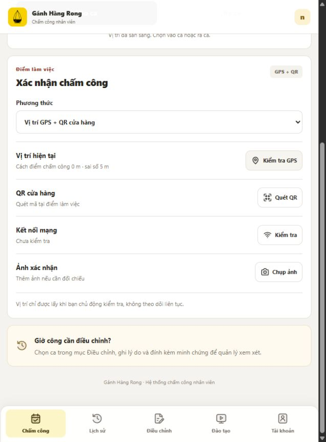
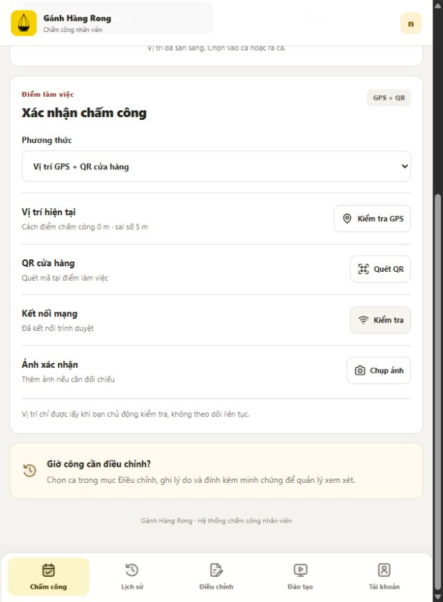
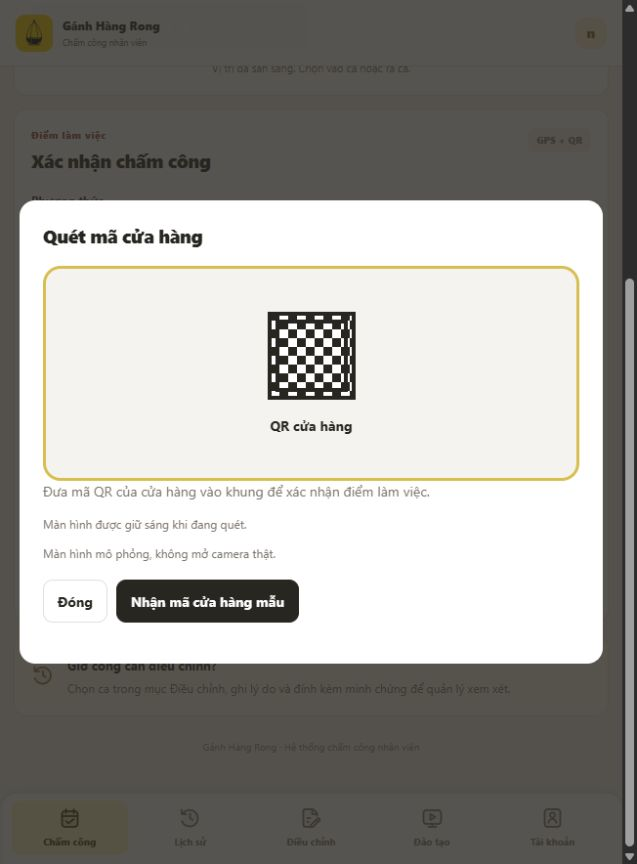
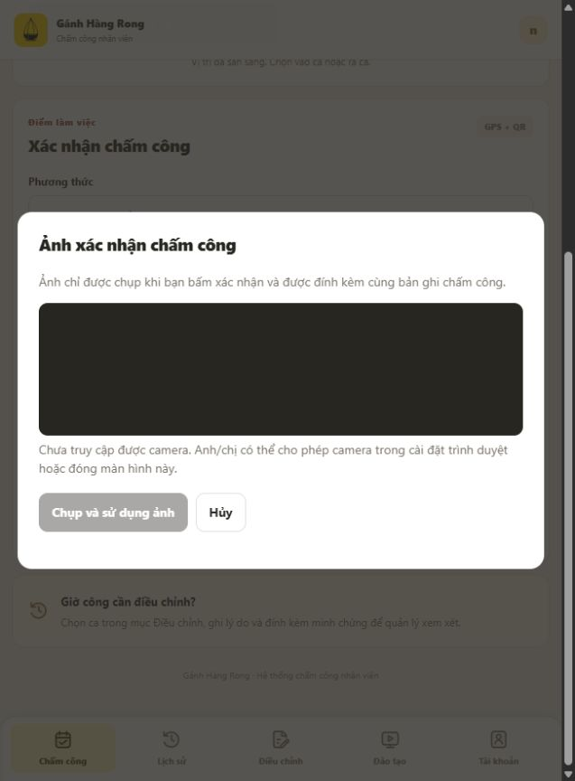
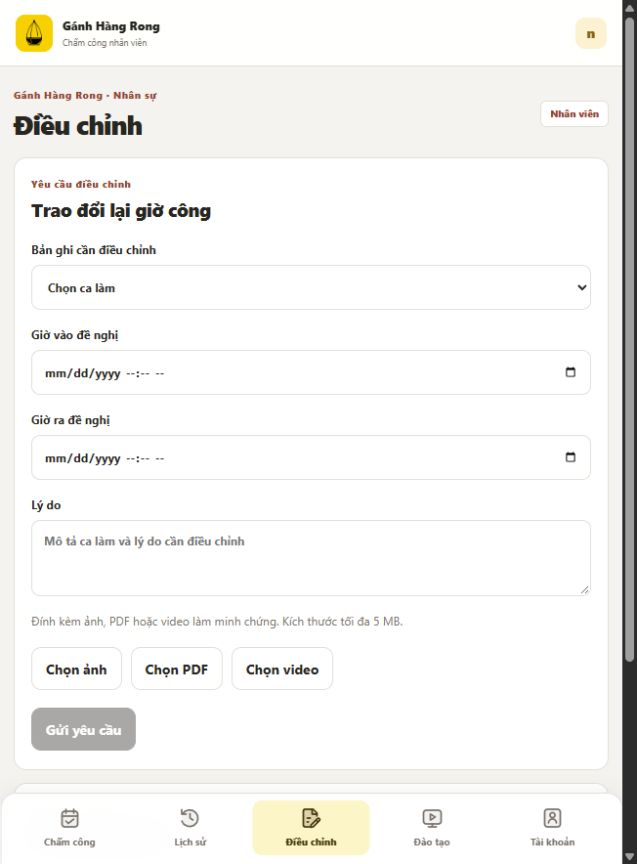
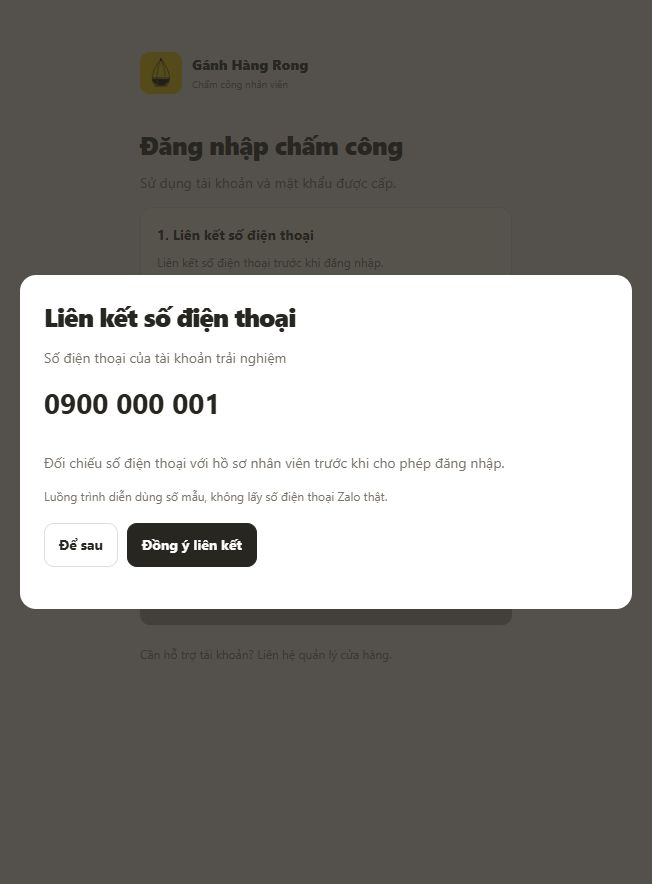
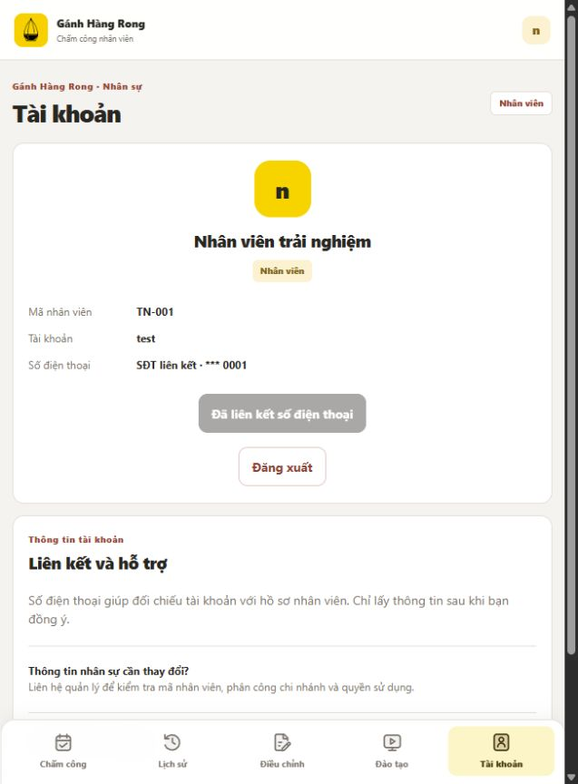
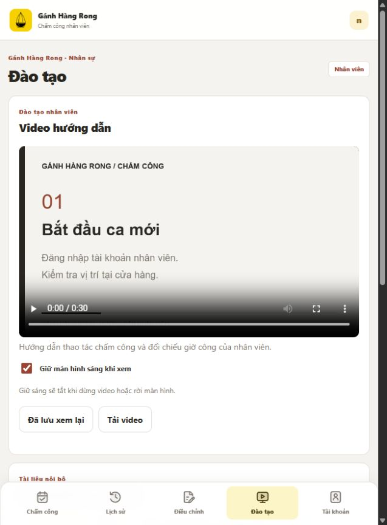
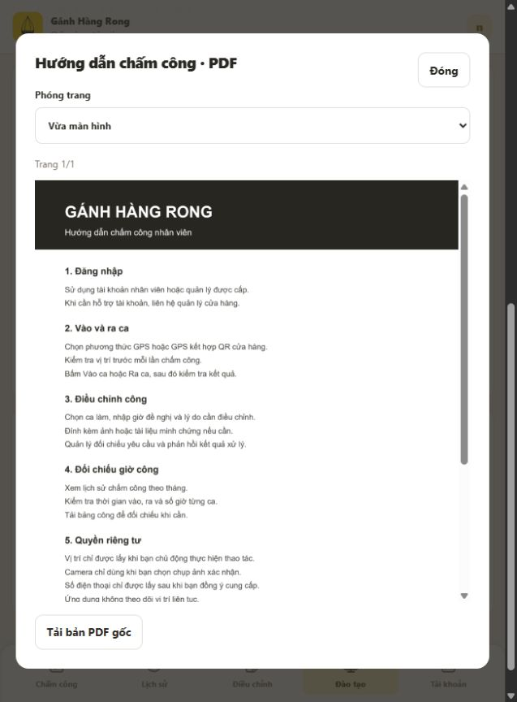

# Bảng giải trình 11 quyền — bản lịch sử 23/10

**Đã có [bảng và ảnh mới theo giao diện Testing6](attendance-permission-explanations-testing6-2026-10-24.md). Dùng bộ mới khi xem luồng hiện tại.**

Cập nhật giao diện: liên kết số điện thoại đã chuyển sang Thông tin tài khoản sau đăng nhập. Ảnh 08 của bản trước chỉ còn là tư liệu lịch sử, cần chụp lại trước khi nộp hồ sơ. Xem [báo cáo giao diện mới](attendance-login-redesign-2026-10-23.md).

Ngày lập: 23/10/2026. Trạng thái: bản nháp nội bộ, ảnh minh họa từ demo đang mở tại localhost:5184. Chưa gửi xin quyền, xét duyệt hoặc xuất bản. Không gọi API Zalo thật.

## Phạm vi bằng chứng

Bộ ảnh mô tả mục đích và giao diện sử dụng quyền; không chứng minh API Zalo đã thực thi hoặc quyền đã được cấp. Ảnh được giữ nguyên từ trình duyệt, không dựng hộp thoại cấp quyền Zalo. Tên quyền bên dưới là tên nghiệp vụ; cần đối chiếu tên API chính xác trong trang quản lý trước khi lập hồ sơ thật.

## Bảng chức năng và lý do đề xuất

| STT | Quyền | Chức năng và thời điểm sử dụng | Lý do xin quyền đề xuất | Ảnh minh họa | Giới hạn hiện tại |
| --- | --- | --- | --- | --- | --- |
| 1 | Quét mã QR | Nhân viên bấm Quét QR tại màn Chấm công, đưa mã cửa hàng vào khung. | Cho phép nhân viên quét mã QR tại điểm làm việc để xác nhận đúng cửa hàng trước khi ghi nhận vào ca hoặc ra ca. Chỉ mở màn quét khi nhân viên chủ động thao tác. | [01 · Màn quét QR](assets/attendance-permissions-2026-10-23/01-qr.png) | Mã mẫu, không mở camera hoặc gọi quét QR Zalo. |
| 2 | Vị trí | Bấm Kiểm tra GPS trước khi chấm công. | Lấy vị trí tại thời điểm nhân viên kiểm tra để đối chiếu khoảng cách với điểm làm việc, hỗ trợ hạn chế chấm công ngoài khu vực cho phép. Không theo dõi vị trí liên tục hoặc chạy nền. | [02 · Kiểm tra vị trí](assets/attendance-permissions-2026-10-23/02-vi-tri.png) | Tọa độ và khoảng cách mẫu, không phải vị trí thiết bị thật. |
| 3 | Trạng thái mạng | Bấm Kiểm tra tại mục Kết nối mạng. | Kiểm tra kết nối khi thực hiện thao tác cần đồng bộ để thông báo tình trạng mất mạng, giúp nhân viên biết khi nào bản ghi chưa thể gửi lên hệ thống. | [03 · Kết nối mạng](assets/attendance-permissions-2026-10-23/03-mang.png) | Ảnh thể hiện trạng thái trình duyệt; chưa gọi API mạng Zalo. |
| 4 | Giữ màn hình sáng | Trong màn quét QR hoặc khi phát video với lựa chọn giữ sáng. | Duy trì màn hình sáng trong lúc nhân viên đang xem hướng dẫn hoặc quét mã để thao tác không bị gián đoạn. Dừng giữ sáng khi đóng màn quét, dừng video hoặc rời màn hình. | [04 · Giữ sáng khi quét](assets/attendance-permissions-2026-10-23/04-giu-sang.png) | Web Wake Lock hoặc trạng thái mô phỏng; chưa chứng minh giữ sáng bằng Zalo trên điện thoại. |
| 5 | Rung thiết bị | Phản hồi ngắn khi thao tác chấm công hoàn tất, đi kèm thông báo trên màn hình. | Tạo phản hồi xúc giác ngắn giúp nhân viên nhận biết kết quả thao tác trong môi trường quán bận rộn. Không rung liên tục hoặc dùng cho quảng cáo. | [05 · Vị trí thao tác chấm công](assets/attendance-permissions-2026-10-23/05-rung.png) | Chỉ là màn ngữ cảnh; ảnh không chứng minh rung. Lượt chụp không tạo bản ghi chấm công mới và chưa kiểm tra rung thiết bị. |
| 6 | Camera | Bấm Chụp ảnh tại mục Ảnh xác nhận. | Cho phép nhân viên chủ động chụp ảnh minh chứng để đính kèm bản ghi chấm công khi cần đối chiếu. Không tự chụp hoặc truy cập camera nền. | [06 · Hộp chụp ảnh](assets/attendance-permissions-2026-10-23/06-camera.png) | Hộp chụp mở nhưng trình duyệt chưa có hình xem trước, nút sử dụng ảnh chưa khả dụng. Chưa có ảnh chụp thành công hoặc bằng chứng camera Zalo. |
| 7 | Chọn ảnh/video/tệp | Màn Điều chỉnh có Chọn ảnh, Chọn PDF và Chọn video. | Cho phép nhân viên chọn minh chứng có sẵn để gửi kèm yêu cầu điều chỉnh giờ công; chỉ sử dụng tệp do nhân viên chủ động chọn. | [07 · Đính kèm minh chứng](assets/attendance-permissions-2026-10-23/07-chon-tep.png) | Ảnh thể hiện điểm chọn tệp; chưa minh họa bộ chọn Zalo hoặc gửi minh chứng thành công. |
| 8 | Số điện thoại | Sau đăng nhập, mở Thông tin tài khoản và đồng ý liên kết số điện thoại. | Sau khi nhân viên đồng ý, sử dụng số điện thoại để đối chiếu tài khoản với hồ sơ được cấp phép. Liên kết số điện thoại là bước nhận diện, không tự cấp quyền nhân viên hoặc quản trị. | [08 · Đồng ý liên kết](assets/attendance-permissions-2026-10-23/08-dien-thoai.png), [08b · Đã liên kết](assets/attendance-permissions-2026-10-23/08-dien-thoai-da-lien-ket.png) | Số mẫu; không lấy số điện thoại Zalo, không xác minh sở hữu số thật. |
| 9 | Lưu video | Màn Đào tạo có phát video, Tải video và Đã lưu xem lại. | Cho phép nhân viên chủ động lưu video đào tạo của quán vào thiết bị để xem lại hướng dẫn thao tác hoặc làm món khi cần. Chỉ thực hiện sau khi người dùng chọn lưu. | [09 · Video và nút tải](assets/attendance-permissions-2026-10-23/09-luu-video.png) | Video hiện là hướng dẫn chấm công mẫu. Đã lưu xem lại là bookmark trong app, không phải lưu gallery/offline. Chưa xác nhận tải vào thiết bị. |
| 10 | Tải tệp | Tải tài liệu hướng dẫn PDF, video hoặc báo cáo cá nhân từ các nút tải. | Cho phép nhân viên tải tài liệu hướng dẫn và nội quy do quán cung cấp hoặc báo cáo giờ công cá nhân để đọc lại, lưu trữ và đối chiếu khi cần. | [10 · Nút tải tệp](assets/attendance-permissions-2026-10-23/10-tai-tep.png), [11 · Tải PDF gốc](assets/attendance-permissions-2026-10-23/11-mo-tai-lieu.png) | Endpoint trả tệp đã được kiểm tra ở lượt trước; ảnh này chỉ cho thấy liên kết tải. Chưa xác nhận lưu vào hệ điều hành/điện thoại. |
| 11 | Mở tài liệu | Bấm Xem PDF tại màn Đào tạo, có phóng trang và tải bản gốc. | Mở tài liệu PDF hướng dẫn và nội quy để nhân viên đọc trực tiếp trong quá trình sử dụng ứng dụng, thuận tiện tra cứu trước hoặc trong ca làm. | [11 · Trình xem PDF](assets/attendance-permissions-2026-10-23/11-mo-tai-lieu.png) | Demo hiển thị ảnh trang kết xuất từ PDF, chưa gọi openDocument Zalo. Tệp mẫu chưa phải nội quy chính thức của quán. |

## Xem ảnh

Ảnh 01 và 04 dùng cùng màn QR vì thể hiện hai mục đích trên cùng một luồng. Ảnh 09 và 10 dùng cùng màn đào tạo vì có nút tải video và lưu xem lại. Không diễn giải ảnh trùng thành những lần kiểm chứng native độc lập.

### 01 — Quét QR

### 02 — Vị trí

### 03 — Mạng

### 04 — Giữ sáng

### 05 — Rung

### 06 — Camera

### 07 — Chọn tệp

### 08 — Điện thoại

### 09 — Video

### 10 — Tải tệp

### 11 — Mở PDF

## Kiểm tra bộ hồ sơ

- Đã lưu 12 ảnh PNG gốc từ giao diện demo cho 11 mục, trong đó điện thoại có thêm một ảnh trạng thái sau liên kết.
- Không ghi mật khẩu, token hoặc thông tin nhân sự thật vào bộ ảnh.
- Chỉ thao tác kiểm tra vị trí/mạng mẫu, mở màn QR/camera/tài liệu và đăng xuất để chụp bước đồng ý điện thoại; không tạo ca công hoặc gửi yêu cầu điều chỉnh mới.
- Không chỉnh sửa mã ứng dụng hoặc dữ liệu nhân sự. Không upload lại Testing trong công việc lưu hồ sơ này.
- Trước hồ sơ xin quyền thật cần kiểm chứng từng API trên Zalo, bổ sung ảnh/video thiết bị và sửa các điểm còn thiếu nêu trong bảng. Bộ hiện tại đủ ảnh minh họa theo 11 mục, chưa phải bộ bằng chứng hoàn tất để gửi duyệt.

Tham chiếu kỹ thuật: [Bốn luồng demo và Testing Version 4](attendance-four-demo-flows-2026-10-23.md).
