# Bảng giải trình 11 quyền và ảnh minh họa — giao diện Testing 6

Cập nhật 24/10/2026. **Bản nháp nội bộ, vẫn demo. Chưa gửi xin quyền, xét duyệt hoặc xuất bản.**

Ảnh chụp trực tiếp từ demo local `http://127.0.0.1:5184/`, viewport390×844, cùng mã nguồn/giao diện đã upload Testing6 (commit `4d2e008`). Không phải ảnh chụp bên trong Zalo điện thoại; không chứng minh API native đã được gọi. Không đổi app hoặc upload thêm trong lượt lập hồ sơ này.

## Phạm vi

- Mỗi quyền có lý do nghiệp vụ và ảnh điểm sử dụng; phần còn thiếu bằng chứng được ghi trong bảng.
- Mã quyền 25/38/48/58/83/87/94/100/105/106/157 lấy từ danh sách dự án trước đó, chưa xác minh lại danh mục console trong lượt này. Tên trong bảng là tên nghiệp vụ.
- Đăng ký dùng số điện thoại là form mô phỏng, chưa tạo Auth/database. Không đồng nghĩa xin quyền chia sẻ SĐT Zalo. Quyền SĐT chỉ xuất hiện khi chủ động mở chia sẻ trong Tài khoản sau đăng nhập.
- Không xin thêm tên/ảnh đại diện trong sheet số điện thoại; không bắt buộc liên kết để chấm công.

## Bảng chức năng và lý do đề xuất

| STT | Quyền | Chức năng và thời điểm sử dụng | Lý do xin quyền đề xuất | Ảnh minh họa | Giới hạn hiện tại |
| --- | --- | --- | --- | --- | --- |
| 1 | Quét mã QR | Nhân viên bấm Quét QR tại màn Chấm công, đưa mã cửa hàng vào khung. | Cho phép nhân viên quét mã QR tại điểm làm việc để xác nhận đúng cửa hàng trước khi ghi nhận vào ca hoặc ra ca. Chỉ mở màn quét khi nhân viên chủ động thao tác. | [01 · Màn quét QR](assets/attendance-permissions-testing6-2026-10-24/01-qr.png) | Mã mẫu, không mở camera hoặc gọi quét QR Zalo. |
| 2 | Vị trí | Bấm Kiểm tra GPS trước khi chấm công. | Lấy vị trí tại thời điểm nhân viên kiểm tra để đối chiếu khoảng cách với điểm làm việc, hỗ trợ hạn chế chấm công ngoài khu vực cho phép. Không theo dõi vị trí liên tục hoặc chạy nền. | [02 · Kiểm tra vị trí](assets/attendance-permissions-testing6-2026-10-24/02-vi-tri.png) | Tọa độ và khoảng cách mẫu, không phải vị trí thiết bị thật. |
| 3 | Trạng thái mạng | Bấm Kiểm tra tại mục Kết nối mạng. | Kiểm tra kết nối khi thực hiện thao tác cần đồng bộ để thông báo tình trạng mất mạng, giúp nhân viên biết khi nào bản ghi chưa thể gửi lên hệ thống. | [03 · Kết nối mạng](assets/attendance-permissions-testing6-2026-10-24/03-mang.png) | Ảnh thể hiện trạng thái trình duyệt; chưa gọi API mạng Zalo. |
| 4 | Giữ màn hình sáng | Trong màn quét QR hoặc khi phát video với lựa chọn giữ sáng. | Duy trì màn hình sáng trong lúc nhân viên đang xem hướng dẫn hoặc quét mã để thao tác không bị gián đoạn. Dừng giữ sáng khi đóng màn quét, dừng video hoặc rời màn hình. | [04 · Giữ sáng khi quét](assets/attendance-permissions-testing6-2026-10-24/04-giu-sang.png) | Web Wake Lock hoặc trạng thái mô phỏng; chưa chứng minh giữ sáng bằng Zalo trên điện thoại. |
| 5 | Rung thiết bị | Phản hồi ngắn khi thao tác chấm công hoàn tất, đi kèm thông báo trên màn hình. | Tạo phản hồi xúc giác ngắn giúp nhân viên nhận biết kết quả thao tác trong môi trường quán bận rộn. Không rung liên tục hoặc dùng cho quảng cáo. | [05 · Vị trí thao tác chấm công](assets/attendance-permissions-testing6-2026-10-24/05-rung-ngu-canh.png) | Chỉ là màn ngữ cảnh; ảnh không chứng minh rung. Lượt chụp không tạo bản ghi chấm công mới và chưa kiểm tra rung thiết bị. |
| 6 | Camera | Bấm Chụp ảnh tại mục Ảnh xác nhận. | Cho phép nhân viên chủ động chụp ảnh minh chứng để đính kèm bản ghi chấm công khi cần đối chiếu. Không tự chụp hoặc truy cập camera nền. | [06 · Hộp chụp ảnh](assets/attendance-permissions-testing6-2026-10-24/06-camera.png) | Hộp chụp mở nhưng trình duyệt chưa có hình xem trước, nút sử dụng ảnh chưa khả dụng. Chưa có ảnh chụp thành công hoặc bằng chứng camera Zalo. |
| 7 | Chọn ảnh/video/tệp | Màn Điều chỉnh có Chọn ảnh, Chọn PDF và Chọn video. | Cho phép nhân viên chọn minh chứng có sẵn để gửi kèm yêu cầu điều chỉnh giờ công; chỉ sử dụng tệp do nhân viên chủ động chọn. | [07 · Đính kèm minh chứng](assets/attendance-permissions-testing6-2026-10-24/07-chon-tep.png) | Ảnh thể hiện điểm chọn tệp; chưa minh họa bộ chọn Zalo hoặc gửi minh chứng thành công. |
| 8 | Số điện thoại | Sau đăng nhập → Tài khoản → Chia sẻ số điện thoại Zalo → bật công tắc → Cho phép. | Xin chia sẻ số điện thoại liên kết với Zalo khi người dùng chủ động đồng ý, để đối chiếu hồ sơ nhân viên. Từ chối không chặn chấm công; không tự thay đổi hồ sơ hoặc cấp quyền tài khoản. | [08 · Bảng chia sẻ](assets/attendance-permissions-testing6-2026-10-24/08-chia-se-sdt.png), [từ chối](assets/attendance-permissions-testing6-2026-10-24/08b-tu-choi.png), [khớp](assets/attendance-permissions-testing6-2026-10-24/08c-khop-ho-so.png), [không khớp](assets/attendance-permissions-testing6-2026-10-24/08d-khong-khop.png) | Sheet tự dựng ghi rõ mô phỏng, không phải hộp cấp quyền Zalo. Không lấy số thật; khớp/không khớp chọn ở phần thử riêng. Tài khoản đã liên kết được giữ nguyên, ảnh khớp không chứng minh tạo liên kết mới. |
| 9 | Lưu video | Màn Đào tạo có phát video, Tải video và Đã lưu xem lại. | Cho phép nhân viên chủ động lưu video đào tạo của quán vào thiết bị để xem lại hướng dẫn thao tác hoặc làm món khi cần. Chỉ thực hiện sau khi người dùng chọn lưu. | [09 · Video và nút tải](assets/attendance-permissions-testing6-2026-10-24/09-luu-video.png) | Video hiện là hướng dẫn chấm công mẫu. Đã lưu xem lại là bookmark trong app, không phải lưu gallery/offline. Chưa xác nhận tải vào thiết bị. |
| 10 | Tải tệp | Tải tài liệu hướng dẫn PDF, video hoặc báo cáo cá nhân từ các nút tải. | Cho phép nhân viên tải tài liệu hướng dẫn và nội quy do quán cung cấp hoặc báo cáo giờ công cá nhân để đọc lại, lưu trữ và đối chiếu khi cần. | [10 · Nút tải tệp](assets/attendance-permissions-testing6-2026-10-24/10-tai-tep.png), [11 · Tải PDF gốc](assets/attendance-permissions-testing6-2026-10-24/11-mo-tai-lieu.png) | Endpoint trả tệp đã được kiểm tra ở lượt trước; ảnh này chỉ cho thấy liên kết tải. Chưa xác nhận lưu vào hệ điều hành/điện thoại. |
| 11 | Mở tài liệu | Bấm Xem PDF tại màn Đào tạo, có phóng trang và tải bản gốc. | Mở tài liệu PDF hướng dẫn và nội quy để nhân viên đọc trực tiếp trong quá trình sử dụng ứng dụng, thuận tiện tra cứu trước hoặc trong ca làm. | [11 · Trình xem PDF](assets/attendance-permissions-testing6-2026-10-24/11-mo-tai-lieu.png) | Demo hiển thị ảnh trang kết xuất từ PDF, chưa gọi openDocument Zalo. Tệp mẫu chưa phải nội quy chính thức của quán. |

## Ảnh minh họa mới

Có14ảnh cho11mục, gồm3ảnh kết quả bổ sung của quyền SĐT. QR và giữ sáng dùng cùng màn; video và tải tệp dùng cùng màn đào tạo. Không coi các ảnh cùng màn là kiểm chứng native độc lập. Một số ảnh chụp toàn trang để thấy đủ vị trí nút, nên cao hơn viewport.

### Quét QR mẫu

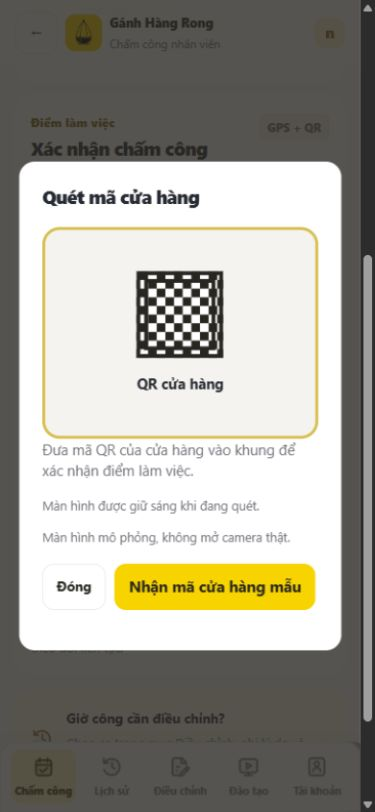

### Vị trí mẫu

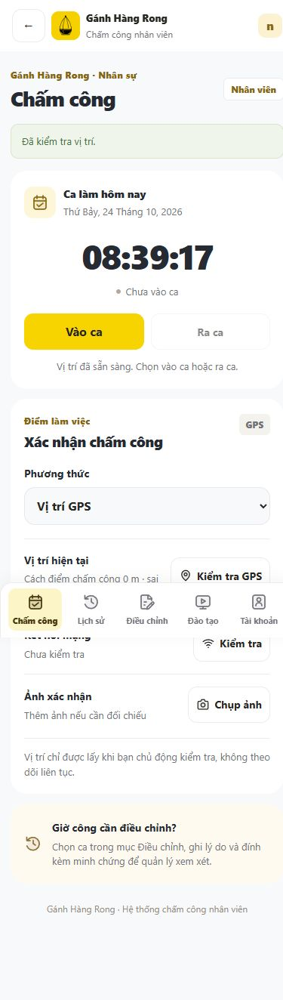

### Kết nối trình duyệt

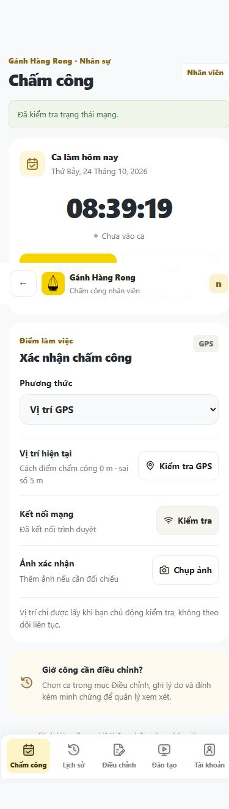

### Giữ sáng khi mở QR

### Ngữ cảnh chấm công, không chứng minh rung

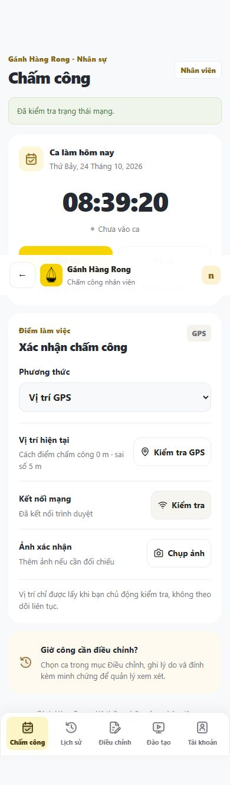

### Camera chưa có hình xem trước

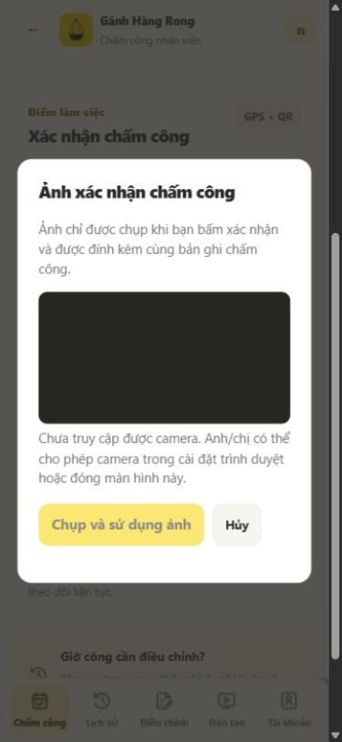

### Chọn minh chứng

### Bảng chia sẻ mô phỏng

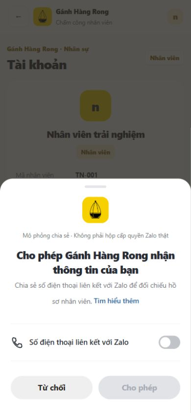

### Từ chối chia sẻ

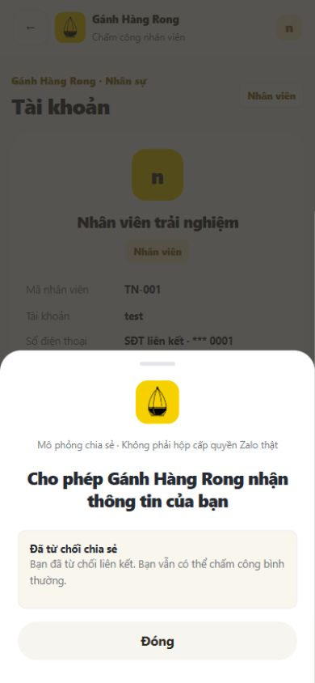

### Đối chiếu mẫu khớp, giữ liên kết cũ

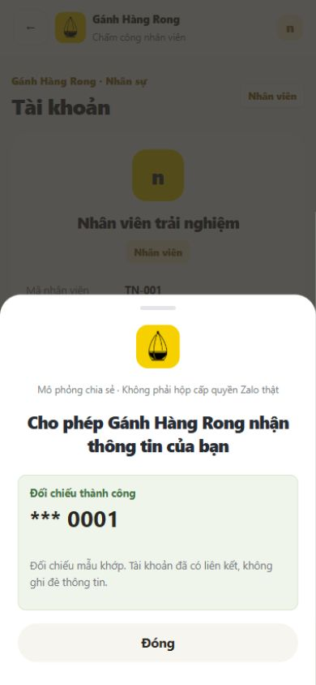

### Đối chiếu mẫu không khớp

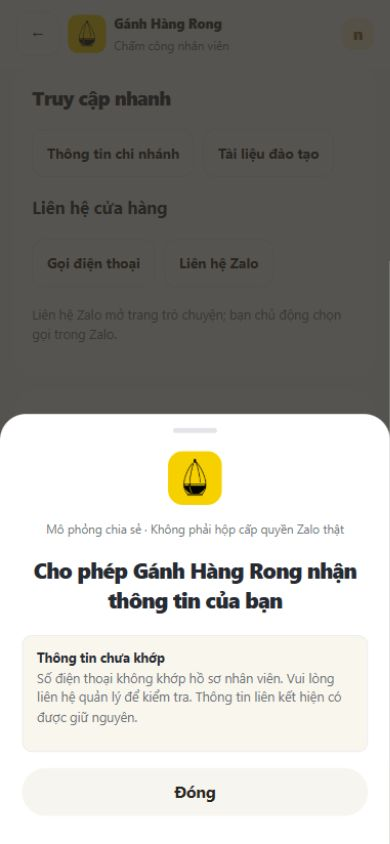

### Video và lưu xem lại

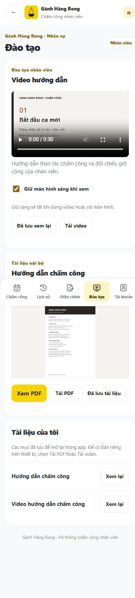

### Điểm tải tệp

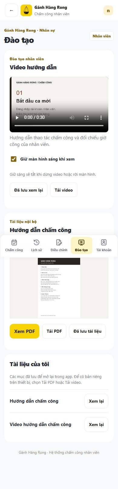

### Trình xem PDF trong demo

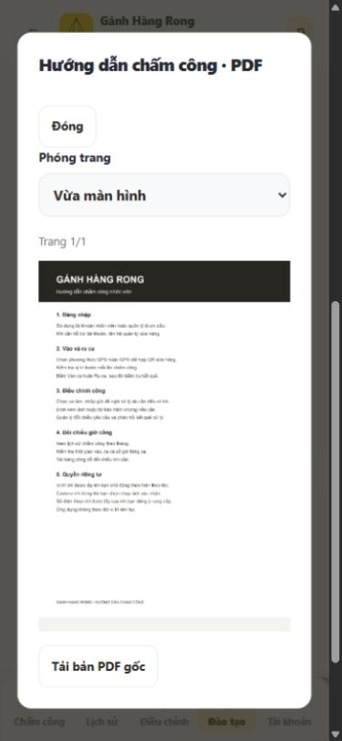

## Giới hạn và kiểm tra bộ hồ sơ

- GPS/QR và điện thoại là dữ liệu mẫu. Mạng là trạng thái trình duyệt; giữ sáng là Web Wake Lock hoặc mô phỏng. Không gọi API Zalo thật.
- Rung chỉ có ảnh ngữ cảnh; không tạo ca công mới để chụp. Camera mở nhưng báo chưa truy cập được và nút chụp bị khóa; chưa có ảnh chứng minh chụp thành công.
- Chọn tệp chỉ chụp điểm vào, không dùng tệp riêng tư hoặc gửi yêu cầu điều chỉnh.
- Video tải được để trình phát sử dụng, bookmark là lưu trong app; chưa chứng minh lưu gallery hoặc xem offline. PDF hiển thị ảnh trang từ PDF, chưa gọi openDocument Zalo. Nút tải không chứng minh file đã lưu xuống điện thoại.
- Lý do về video làm món/nội quy áp dụng khi có tài liệu thật; bản hiện tại chỉ dùng video/PDF hướng dẫn chấm công mẫu, chưa phải nội quy chính thức hoặc công thức của quán.
- Bộ này phục vụ duyệt nội bộ giao diện và nội dung giải trình. Trước hồ sơ thật cần kiểm chứng runtime/permission trên Zalo, bổ sung video hoặc ảnh thiết bị thực cho các quyền còn thiếu.
- Không có mật khẩu, token hoặc thông tin nhân sự thật trong bộ ảnh. Tài khoản trải nghiệm được che số. Không thay đổi DB, không gửi yêu cầu chấm công/điều chỉnh mới; ảnh khớp giữ liên kết có sẵn.

Tham chiếu: [mốc Testing6](attendance-testing-v6-2026-10-24.md), [luồng chia sẻ](attendance-phone-link-demo-2026-10-24.md), [UI consistency](attendance-ui-consistency-2026-10-24.md). [Bộ ảnh23/10](attendance-permission-explanations-2026-10-23.md) chỉ còn là lịch sử.
