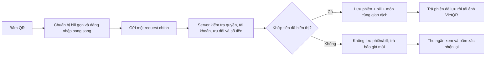

# POS 0.4.38 — một yêu cầu kiểm tra quyền lợi và tạo phiên QR

## Kết quả

Đơn QR ngân hàng thông thường tại quầy dùng `create_checkout_v2`. POS không tra lại tài khoản loyalty/hồ sơ/quy tắc trước request này; chỉ gửi lựa chọn ưu đãi, bill/món và số tiền đang hiển thị. Không gửi bản sao CRM trong checkout hoặc metadata đơn. Đăng nhập vẫn được chuẩn bị song song như 0.4.37.

Server xác thực nhân viên, đọc tài khoản nhận tiền từ cấu hình rồi gọi một RPC. Trong giao dịch, RPC khóa mã yêu cầu và dữ liệu quyền lợi, tính lại giảm voucher/điểm/tổng tiền bằng dữ liệu server, so sánh với tiền POS đã hiển thị, sau đó gọi giao dịch lưu phiên/đơn/món hiện có. Tổng món được đối chiếu từ các line_total theo hợp đồng đơn POS hiện tại; không thay bộ giá món/tùy chọn hay quy tắc khuyến mãi bằng một bộ giá mới.

Voucher dùng lại `loyalty_private.evaluate_order_voucher` và bộ giải cấu hình hiện có; bổ sung kiểm tra POS/chi nhánh/loại khách tương ứng điều kiện native. Điểm dùng rule version đang active, giới hạn cấu hình và giới hạn voucher + điểm đang có. Số dư khả dụng được đối chiếu thêm với các lô điểm còn hạn giống guard SPEND hiện tại, không thay chính sách hết hạn. Giữ quy trình SPEND sau khi nhận thanh toán; không tự trừ điểm lúc tạo QR.

Nếu quyền lợi thay đổi, server trả `benefits_changed` và báo giá gọn, không tạo phiên/bill. POS cập nhật thông tin và hiện **Xác nhận số tiền mới và tạo QR**; không tự gửi lại. Nếu giỏ thay đổi khác báo giá đó thì chặn, yêu cầu kiểm tra giỏ. Nếu về 0đ, đóng QR để dùng xác nhận đơn 0đ hiện có. Gửi lại cùng mã của một phiên đã lưu trả snapshot cũ, không tính lại ngân hàng/số tiền của QR mà khách có thể đã quét.

Một request chính là trường hợp thông thường. Làm mới đăng nhập hoặc phục hồi một bản nháp khác vẫn có thể cần request riêng để giữ an toàn. Giao dịch đổi tem và MoMo giữ nhánh cũ; website và ảnh VietQR không thay đổi. Máy POS cũ tiếp tục `create_checkout`/`create` như trước.

## So sánh

| Luồng | Kiểm tra quyền lợi | Lưu phiên/đơn |
|---|---|---|
| Trước Pay2S, commit a41693c | Tra khách đầy đủ trên POS khi dùng điểm/voucher | Các bước riêng |
| 0.4.37 | Ba đọc gọn song song trên POS; snapshot khách thu nhỏ | Một giao dịch server |
| 0.4.38 | Trong cùng request/giao dịch server tạo phiên, không đọc quyền lợi trước request trên POS | Giữ một giao dịch server; đổi tiền phải xác nhận lại |

## Triển khai

- Migration `20261103013245_pos_server_benefit_checkout.sql` đã áp dụng: RPC mới chỉ service_role được gọi, máy cũ không đổi. Dùng helper private chỉ đọc/khóa hàng, không cấp UPDATE bảng loyalty hay quy tắc cho service/client.
- Migration `20261103015003_pos_server_quote_wallet_dates.sql` đã áp dụng: lọc voucher hết hạn trước khi lấy tám voucher trong báo giá, tránh các voucher cũ che voucher còn dùng được. Giữ lịch sử migration đã áp dụng, không ghi đè migration đầu.
- `pos-payment-session-api` v49 ACTIVE, verify_jwt=true. Đã đọc lại source triển khai, khớp source đã kiểm tra. Không sửa webhook Pay2S/SePay, Zalo hay cấu hình nhận tiền.
- Security advisor trước/sau vẫn sáu phát hiện cũ, không có phát hiện mới. Client không được gọi RPC service/helper.

## Kiểm tra

- 7 suite Jest / 41 bài đạt: tạo/khôi phục QR, auth, snapshot gọn, giới hạn điểm, đổi tem; thêm kiểm tra quote không tự retry, không hiện QR, cần bấm xác nhận, và nhánh báo giá 0đ.
- 20 bài Node đạt, gồm RPC builder Supabase thật, v2 gọi đúng một RPC, không trả session khi cần xác nhận, bank snapshot và hồi quy webhook SePay/Pay2S.
- SQL chạy bằng role service_role trong BEGIN/ROLLBACK đạt trước và sau triển khai: SePay/Pay2S; điểm giảm/điểm hết hạn; checkout voucher và loyalty voucher; voucher bị dùng/không đúng kênh; lỗi món hoàn tác cả phiên; retry không nhân đôi; hủy/hết hạn không tái dùng; phục hồi claims và kiểm tra quyền.
- SQL hồi quy v1 và đổi 10 tem/null defaults đạt. Vì lúc kiểm tra không có ca mở, tạo ca giả trong cùng transaction rồi rollback; không mở ca thật. Kiểm tra sau đó không còn profile/session/ca thử. Điểm cấp cho fixture qua ledger cũng rollback, không chỉnh số dư khách thật.
- Lint runtime native, TypeScript Edge, encoding và npm run build đạt. Gradle signed release build đạt.

Chưa cài trên máy quầy, chưa đo tốc độ trước/sau trên thiết bị, chưa chuyển tiền thật hoặc xác nhận giấy in cho riêng 0.4.38. Không cam kết số giây và không gọi đây là tối ưu nhất khi chưa có số đo thực tế. Đã giữ log số đo không có dữ liệu riêng từ 0.4.37 để đối chiếu khi thử máy.

## APK bàn giao

`ghr-pos-mobile-native/releases/GHR-POS-0.4.38.apk`, versionCode **69**, package `vn.ghr.posmobile`, arm64-v8a/armeabi-v7a, 31.772.647 byte.

SHA-256 `fbb892ef428e7b184d70c2d267d0d38f6aadbf3e11b248a575544d41e0b8bb81`.

Chữ ký SHA-256 `728d5843ae0c8883171fdae3fd65b6375810d27ed946297c5cee3a51b62224ea`, khớp bản cũ. Bytecode trong APK khớp bundle cuối: `1dd9ea161821a588bfa5bfaa19971e284d62b8a77c14d2f4a1296ad561b261c0`.

Anh cài đè thử tại 30/4. Thử bill thường, dùng điểm/voucher, retry/đóng mở lại, hủy và đơn 0đ/đổi tem; anh tự chuyển thử, kiểm tra Kitchen và bill. Nếu upload qua Admin, nhập mã Android **69**. Chưa đổi metadata cập nhật APK toàn hệ thống.

## Danh sách file

Cập nhật:

- `ghr-pos-mobile-native/android/app/build.gradle`
- `ghr-pos-mobile-native/src/features/pos/hooks/usePosComposer.js`
- `ghr-pos-mobile-native/src/features/pos/components/QrPaymentModal.js`
- `ghr-pos-mobile-native/src/screens/PosHomeScreen.js`
- `ghr-pos-mobile-native/src/services/pos/posPaymentSessionService.js`
- `ghr-pos-mobile-native/__tests__/posCombinedQrCheckout.test.js`
- `scripts/pos-qr-checkout.test.mjs`
- `supabase/functions/_shared/posQrCheckout.ts`
- `supabase/functions/pos-payment-session-api/index.ts`

Tạo:

- `ghr-pos-mobile-native/__tests__/posQrBenefitConfirmation.test.js`
- `supabase/migrations/20261103013245_pos_server_benefit_checkout.sql`
- `supabase/migrations/20261103015003_pos_server_quote_wallet_dates.sql`
- `docs/supabase-sql/pos-server-benefit-checkout.sql`
- `docs/supabase-sql/pos-server-quote-wallet-dates.sql`
- `docs/supabase-sql/pos-server-benefit-checkout-test.sql`
- Báo cáo này; APK ngoài Git.
